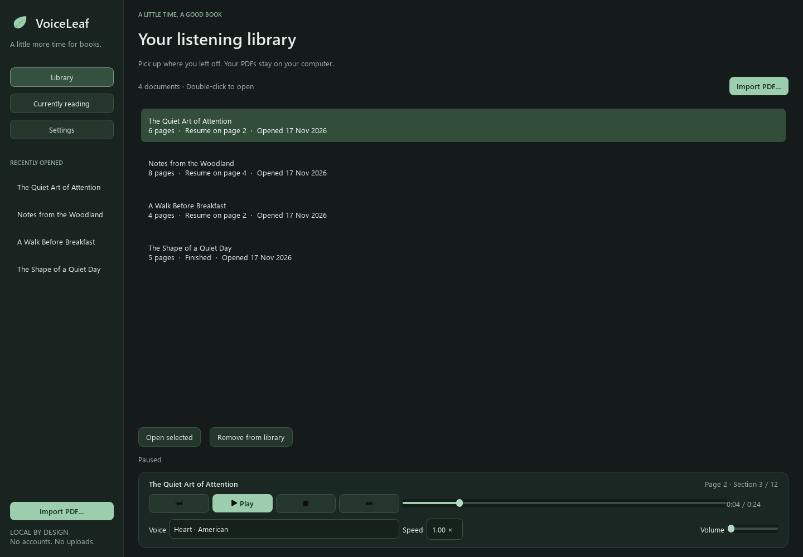

# VoiceLeaf

**A little more time for books.**

VoiceLeaf is a local Windows PDF audiobook reader. View a PDF and listen using natural Kokoro voices on your CPU. No account, paid API, backend, Docker, or GPU is required. After dependencies and model files are installed, reading and fresh narration work offline.


*Read at your own pace. Listen with natural voices. Follow the spoken line as it moves through your PDF.*

## Screenshots

| Your listening library | PDF and Text view |
| --- | --- |
| [](docs/screenshots/library.png) | [](docs/screenshots/text-view.png) |
| Pick up where you left off with saved reading progress. | Follow synchronized highlighting in the PDF and extracted text. |

*Captured from the application using original sample documents and a separate demo library. Click a gallery image to view it at full size.*

## Features

- Dark, resizable PySide6 interface with a library, recent documents, PDF viewer, optional text view, settings, and playback bar.
- Page navigation, fit-width/fit-page/manual zoom, and PDF drag-and-drop.
- Installed American and British English voices, 0.5×–2.0× narration speed, volume, play/pause/resume/stop, previous/next section, and seeking within generated audio.
- Page-aware sentence/paragraph chunks, automatic section/page continuation, and two sections prepared ahead.
- Synchronized line highlighting in the PDF and Text view, with automatic scrolling to the spoken line.
- SQLite library and saved page, section, audio position, active voice/rate, and preferred voice/rate.
- Explicit model setup with progress, cancellation, checksums, retry, and manual file selection.
- Reusable audio cache limited to 2 GB, local settings, and diagnostic logs.

## Requirements

- **Windows 10 version 1809 or later, or Windows 11; x64.** Windows ARM64 and 32-bit Python are outside the MVP's tested target.
- **Python 3.12 x64.** An unrelated Python 3.10 executable on PATH is insufficient.
- Internet during dependency installation and the one-time ~354 MB model download.
- Space for Python dependencies, 354 MB of models, and up to 2 GB of cached audio. 8 GB RAM is a practical starting point; CPU performance determines generation latency.
- A Windows audio output for listening.

Pinned core versions: PySide6 6.10.3, PyMuPDF 1.26.7, kokoro-onnx 0.6.1, soundfile 0.13.1, NumPy 2.5.5, and CPU onnxruntime 1.32.0. Development tools: pytest 9.2.0 and pytest-qt 4.5.0. Installation uses Windows wheels; a C++ compiler is not normally needed.

## Quick start in PowerShell

```powershell
Set-Location 'S:\dewmi\IT Projects\Text2Voice'
.\scripts\setup.ps1
.\scripts\run.ps1
```

Setup checks Python 3.12 x64, creates `.venv`, and installs the project and test dependencies. It checks the Python launcher, PATH, uv-managed installations, and the usual Python 3.12 directory. It does not download models silently or change global Python packages.

If Python 3.12 is not registered with the launcher, provide its executable. On the development machine:

```powershell
.\scripts\setup.ps1 -Python 'C:\Users\dewmi\AppData\Roaming\uv\python\cpython-3.12.7-windows-x86_64-none\python.exe'
```

Open a document immediately:

```powershell
.\scripts\run.ps1 -Pdf 'C:\Books\My Book.pdf'
```

If script execution is restricted, use a process-local override:

```powershell
powershell -NoProfile -ExecutionPolicy Bypass -File .\scripts\setup.ps1
powershell -NoProfile -ExecutionPolicy Bypass -File .\scripts\run.ps1
```

### Manual environment setup

```powershell
py -3.12 -m venv .venv
.\.venv\Scripts\python.exe -m pip install -e '.[dev]'
.\.venv\Scripts\python.exe -m voiceleaf
```

If `py -3.12` cannot locate Python, replace it with `& 'C:\path\to\Python312\python.exe'` in the first command. To use the short entry point, activate the environment:

```powershell
.\.venv\Scripts\Activate.ps1
python -m voiceleaf
```

`run.ps1` uses `.venv` directly, so activation is optional with that script.

## AI model setup

On first launch, choose **Download official files**, **Use selected files**, or **Set up later**. PDF viewing works without models. Return through **Settings → Set up voices**.

Downloads come from the [kokoro-onnx maintainer's model release](https://github.com/thewh1teagle/kokoro-onnx/releases/tag/model-files-v1.1):

| File | Size |
| --- | ---: |
| `kokoro-v1.0.onnx` | 325,505,369 bytes |
| `voices-v1.0.bin` | 28,214,398 bytes |

The full-precision English model and voice bank total 353.7 MB. Their published SHA-256 digests are pinned and verified before files are installed. Partial downloads are not installed; verified completed files are reused on retry. If release assets change in the future, the manifest needs review rather than silently accepting different bytes.

After downloading, choose **Use selected files**. Loading and validation run in a background process. English voices are discovered from the installed bank; Heart (`af_heart`) is preferred when present. See the [official voice list](https://huggingface.co/hexgrad/Kokoro-82M/blob/main/VOICES.md).

Alternatively, download the two files yourself and select them in the dialog. Manual files may remain in their existing directory and are validated by the ONNX/voice loader. They need not match the bundled download manifest.

An explicit command-line downloader is also available:

```powershell
.\.venv\Scripts\python.exe scripts\download_models.py
# Explicitly accept the displayed ~354 MB download:
.\.venv\Scripts\python.exe scripts\download_models.py --yes
```

The default destination is `%LOCALAPPDATA%\VoiceLeaf\models`. Model binaries are ignored by Git. Runtime phonemization uses packaged eSpeak resources; no spaCy/NLTK model download is needed.

## Reading and playback

1. Import or drop a PDF. Its first page appears while extraction continues.
2. Inspect page navigation, zoom, and **Text view**. Wait for document preparation and voice loading.
3. Choose a voice and speed, then press **Play**. Narration starts when the first section is ready.
4. Pause/resume, change volume, seek within that section, or skip sections. Playback automatically continues through the book.

Voice and speed changes apply to the **next section**. The current audio retains its existing voice/rate; changes made before a section starts replace its pending recipe. Volume changes immediately. **Stop** resets the current section to its beginning. Navigating to another PDF page stops narration and selects the first readable section on or after that page. Blank pages are skipped, and trailing blank pages do not restart earlier text.

The slider shows the **current section**, not whole-book time. Kokoro generates speech at the selected rate. Audio is cached separately for each text/voice/rate/model combination.

**Highlight** is enabled by default. The current PDF line is tinted green and kept in view; Text view highlights the same source line. The highlight stays put while paused, follows seeking, and clears when you stop or change documents. Turn off **Highlight** in the reader toolbar to browse without automatic following. A word split across two PDF lines can briefly highlight both lines.

Highlighting uses the model's phoneme timings, aligned to the extracted text. Older manually selected models without duration output use approximate timing. Previously generated sections may be regenerated once to add cached timing data; existing models and saved reading positions remain usable.

Progress is saved every five seconds and on key playback/navigation actions, document changes, and exit. Reopening restores page, section, and feasible audio offset without autoplay. The last available document reopens at startup. Changed PDF contents reset incompatible progress; identical contents at a new location retain their identity.

Double-click a library entry or choose **Open selected**. Its context menu offers **Locate PDF**. Removing an entry never deletes the original PDF. Selecting different contents during relocation opens a separate document.

| Shortcut | Action |
| --- | --- |
| Ctrl+O | Import PDF |
| Space | Play / pause |
| Ctrl+Left / Ctrl+Right | Previous / next section |
| Ctrl+L | Library |
| Ctrl+, | Settings |

## Local storage

All application state is local under `%LOCALAPPDATA%\VoiceLeaf`:

```text
settings.json          Preferences and selected model paths
library.sqlite3        Library metadata and reading progress
library.sqlite3-*      SQLite transaction files, when present
models/                Downloaded models
audio/                 Generated WAVs and timing sidecars, limited to 2 GB
logs/                  Application and worker logs
```

PDF originals are opened in place, without copying or uploading. Network access occurs only during an explicit model download or when opening an external source link. Settings provides **Clear generated audio** and **Open data folder**.

Use a different local folder for portable operation or isolated tests:

```powershell
$env:VOICELEAF_DATA_DIR = 'D:\VoiceLeafData'
.\scripts\run.ps1
```

Existing models elsewhere can be selected manually. The downloader also accepts `--data-dir 'D:\VoiceLeafData'`.

## Tests and verification

Normal tests generate small PDFs and mock AI synthesis; they never download models:

```powershell
.\.venv\Scripts\python.exe -m pytest
.\.venv\Scripts\python.exe -m pip check
```

Coverage includes extraction/rendering, columns, header cleanup, scanned/blank/encrypted/corrupt PDFs, chunk boundaries and mappings, settings, SQLite progress, cache reuse/pruning, download failures/checksums/cancellation, rapid playback controls, stale results, shutdown, and the UI.

Real integration tests explicitly require installed models:

```powershell
$env:VOICELEAF_TEST_MODELS = Join-Path $env:LOCALAPPDATA 'VoiceLeaf\models'
.\.venv\Scripts\python.exe -m pytest -m integration -s
```

They verify two real CPU voices, valid audio samples, Qt decoding, pause/resume/seek, automatic continuation, and a complete PDF window flow including voice/rate changes and restart/resume. Automated playback is muted. UI screenshots and real sample WAVs are generated under the ignored `.artifacts/` directory.

Normal UI tests use Qt's offscreen platform. To run the full reader test with native Windows widgets:

```powershell
$env:QT_QPA_PLATFORM = 'windows'
.\.venv\Scripts\python.exe -m pytest -m integration tests\test_integration.py::test_real_pdf_window_full_reading_flow -s
Remove-Item Env:QT_QPA_PLATFORM
```

The real entry point also supports a brief launch check, without first-run setup:

```powershell
.\.venv\Scripts\python.exe -m voiceleaf --smoke-test
# Equivalent script check:
.\scripts\run.ps1 -SmokeTest
```

### Manual acceptance check

1. Launch, import a text-based PDF, and confirm its pages render and Text view contains readable text.
2. Select Heart and confirm narration is audible through speakers/headphones.
3. Pause/resume, change volume, and seek within the generated section.
4. Select Michael and a different speed; confirm the next section uses them.
   Confirm the green highlight follows the spoken PDF line, including after a seek; use **Highlight** to turn following off/on.
5. Let playback cross sections and pages; confirm the viewer follows.
6. Navigate to another page; confirm narration stops and Play starts its readable text.
7. Close while paused, reopen, and confirm the saved page/section/position.
8. Remove the library entry and verify the original PDF remains.
9. With an isolated empty data directory, confirm setup explains the download and can be postponed.
10. Disconnect networking after setup and confirm an uncached section still generates.

## Troubleshooting

**Wrong Python / `No module named voiceleaf`:** use `run.ps1` or `.venv\Scripts\python.exe -m voiceleaf`. Global Python 3.10 does not share this environment. Supply `setup.ps1 -Python` if needed. Rename an existing incompatible `.venv` before recreating it.

**Dependency or model download fails:** check connectivity, proxy/firewall, free disk space, and access to PyPI/GitHub releases. Retry in setup or transfer the two official files from another machine. Checksum failures preserve previously installed files. Narration does not require internet after installation.

**ONNX Runtime/eSpeak DLL error:** confirm x64 Python and the pinned packages. ONNX Runtime's Windows packages require compatible Visual C++ runtime libraries; install/repair the x64 runtime from [Microsoft's supported downloads](https://learn.microsoft.com/en-us/cpp/windows/latest-supported-vc-redist). See [ONNX Runtime installation requirements](https://onnxruntime.ai/docs/install/). A stale `PHONEMIZER_ESPEAK_LIBRARY` environment variable may override bundled eSpeak resources.

**PDF renders but cannot be narrated:** scanned/image-only PDFs require OCR, planned for a later release. Encrypted PDFs require an unlocked copy. Inspect Text view. Very short documents may have only one section.

**Reading order is wrong:** PDF text order is not guaranteed. Ordinary prose and clear columns are handled conservatively; complex magazines, tables, formulas, and footnotes may remain imperfect. Inspect Text view for those documents.

**No sound:** check app volume, the Windows mixer, and the default playback device. Confirm another app can play audio. Restart VoiceLeaf after switching devices if necessary. Seek controls require loaded, seekable audio.

**First playback is slow:** model loading and first CPU inference take time. The interface stays responsive. Only small sections are synthesized; cached sections replay quickly. Skipping cancels queued work, while an already-running native inference may finish before the new section starts.

**Settings/progress cannot be saved:** check data-folder write access or choose a writable `VOICELEAF_DATA_DIR`. Avoid multiple copies using the same data directory while clearing audio or changing models.

**Diagnostics:** open Settings → Open data folder. Application logs are in `logs/voiceleaf.log`; PDF and TTS worker diagnostics are in separate `pdf-worker.log` and `tts-worker.log` files. Errors are displayed in the UI. Worker logs include tracebacks; the main application log rotates.

## Project structure and architecture

```text
pyproject.toml              Package metadata, dependencies, pytest configuration
AGENTS.md                   Future development instructions
scripts/
  setup.ps1                 Python 3.12 environment and dependency setup
  run.ps1                   Launch through the local virtual environment
  download_models.py        Explicit, verified model downloader
src/voiceleaf/
  __main__.py, app.py        Module entry point and startup
  domain.py                 Typed document/page/chunk/progress/audio records
  config.py                 Application paths and validated settings
  documents.py, pdf.py       Async coordination and isolated PDF service
  text.py                   Layout cleanup and page-bound chunking
  timing.py                 Phoneme-to-word timing alignment for line following
  models.py                 Model manifest, checksums, and downloads
  tts.py                    CPU synthesis and atomic WAV cache
  audio.py, playback.py      Qt adapter and narration state machine
  persistence.py            SQLite library and reading progress
  workers.py                Serial process workers and tagged results
  logging_setup.py          Application logging
  ui/                       Window, library, viewer, playback, setup, theme
tests/                      Unit, UI, and opt-in real-model integration tests
```

PyMuPDF runs exclusively in one process because its [documentation warns against multithreaded use](https://pymupdf.readthedocs.io/en/latest/recipes-multiprocessing.html). Kokoro runs in another process. Generation identifiers reject stale results after rapid controls or document changes. Qt widgets, media playback, and short persistence operations remain on the GUI thread. Shutdown saves progress, unloads audio, cancels queued tasks, and terminates isolated native workers when necessary.

## Roadmap

1. Optional offline OCR for scanned PDFs.
2. Improved chapter, table, footnote, and complex-layout handling.
3. Windows installer/EXE packaging and broader audio-device testing.
4. Word-level highlighting and richer bookmarks.
5. Additional languages after validating their voices and phonemization.

