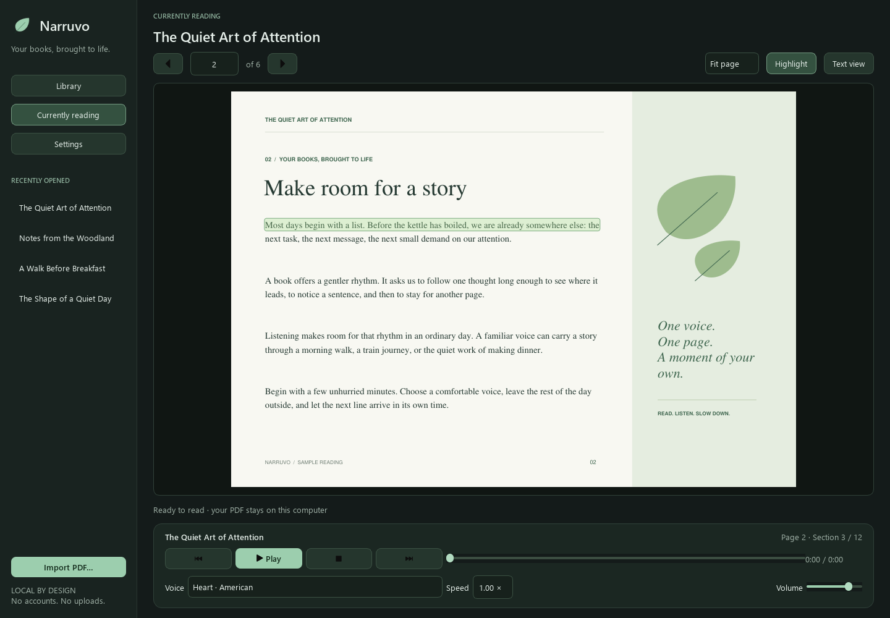
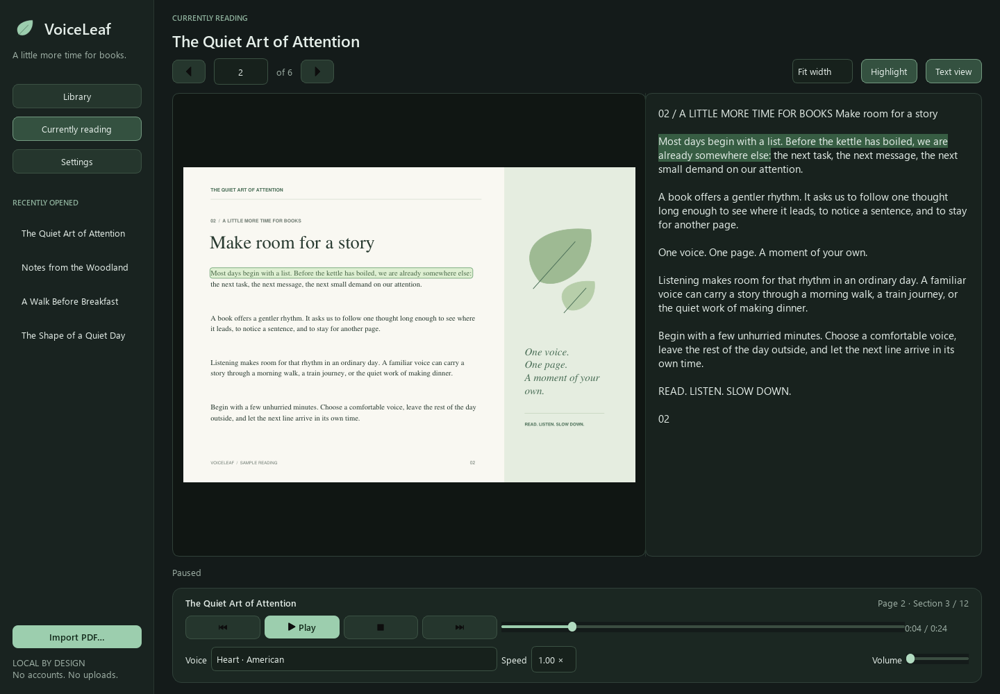

# VoiceLeaf

**A little more time for books.**

VoiceLeaf is a local Windows PDF audiobook reader. View a PDF and listen using natural Kokoro voices on your CPU. No account, subscription, or GPU is required. After the one-time voice setup, reading and fresh narration work offline.



*Read at your own pace. Listen with natural voices. Follow the spoken line as it moves through your PDF.*

## Screenshots

| Your listening library | PDF and Text view |
| --- | --- |
| [](docs/screenshots/library.png) | [](docs/screenshots/text-view.png) |
| Pick up where you left off with saved reading progress. | Follow synchronized highlighting in the PDF and extracted text. |

*Captured from the application using original sample documents and a separate demo library. Click a gallery image to view it at full size.*

## Features

- Dark, resizable interface with a library, recent documents, PDF viewer, optional text view, settings, and playback bar.
- Page navigation, fit-width/fit-page/manual zoom, and PDF drag-and-drop.
- Installed American and British English voices, 0.5×–2.0× narration speed, volume, play/pause/resume/stop, previous/next section, and seeking within generated audio.
- Automatic continuation through sections and pages, with responsive playback controls.
- Synchronized line highlighting in the PDF and Text view, with automatic scrolling to the spoken line.
- A local library with saved reading positions and voice/rate preferences.
- Explicit model setup with progress, cancellation, checksums, retry, and manual file selection.
- Reusable audio cache limited to 2 GB, local settings, and diagnostic logs.

## Requirements

- **Windows 10 version 1809 or later, or Windows 11; x64.** Windows ARM64 and 32-bit Python are outside the MVP's tested target.
- Internet to download the installer and, when explicitly requested, approximately 354 MB of voice models.
- Space for the application, 354 MB of models, and up to 2 GB of cached audio. 8 GB RAM is a practical starting point; CPU performance determines generation latency.
- A Windows audio output for listening.

The installer includes Python and the app dependencies; no separate development environment is needed.

## Install on Windows

Open [Releases](https://github.com/Dewmith/Text2Voice/releases), expand **Assets**, and download `VoiceLeaf-<version>-windows-x64-setup.exe`. Run it to install for your Windows account, then open **VoiceLeaf** from the Start menu. Python, eSpeak, administrator rights, and a separate dependency setup are not required. Desktop shortcuts are optional.

The installer does not download voice models. On first launch, choose an explicit model download, select existing files, or postpone setup and use PDF viewing. Reading and narration work offline after model setup. Installation upgrades the same app location; uninstalling preserves `%LOCALAPPDATA%\VoiceLeaf` and original PDFs.

Initial installers are unsigned, so Windows may display an unknown-publisher or SmartScreen prompt. Download only from this repository's release assets. To compare an installer against its accompanying `.sha256` file:

```powershell
Get-FileHash .\VoiceLeaf-0.1.0-windows-x64-setup.exe -Algorithm SHA256
Get-Content .\VoiceLeaf-0.1.0-windows-x64-setup.exe.sha256
```

## AI model setup

On first launch, choose **Download official files**, **Use selected files**, or **Set up later**. PDF viewing works without models. Return through **Settings → Set up voices**.

Downloads come from the [kokoro-onnx maintainer's model release](https://github.com/thewh1teagle/kokoro-onnx/releases/tag/model-files-v1.1):

| File | Size |
| --- | ---: |
| `kokoro-v1.0.onnx` | 325,505,369 bytes |
| `voices-v1.0.bin` | 28,214,398 bytes |

The full-precision English model and voice bank total 353.7 MB. Their published SHA-256 digests are pinned and verified before files are installed. Partial downloads are not installed; verified completed files are reused on retry. If verification fails, retry setup or select trusted files manually.

After downloading, choose **Use selected files**. Loading and validation run in a background process. English voices are discovered from the installed bank; Heart (`af_heart`) is preferred when present. See the [official voice list](https://huggingface.co/hexgrad/Kokoro-82M/blob/main/VOICES.md).

Alternatively, download the two files yourself and select them in the dialog. Manual files may remain in their existing directory and are validated by the ONNX/voice loader. They need not match the bundled download manifest.

The default destination is `%LOCALAPPDATA%\VoiceLeaf\models`. The installer includes the voice-processing resources needed to work offline.

## Reading and playback

1. Import or drop a PDF. Its first page appears while extraction continues.
2. Inspect page navigation, zoom, and **Text view**. Wait for document preparation and voice loading.
3. Choose a voice and speed, then press **Play**. Narration starts when the first section is ready.
4. Pause/resume, change volume, seek within that section, or skip sections. Playback automatically continues through the book.

Voice and speed changes apply to the **next section**. The current audio retains its existing voice/rate; changes made before a section starts replace its pending recipe. Volume changes immediately. **Stop** resets the current section to its beginning. Navigating to another PDF page stops narration and selects the first readable section on or after that page. Blank pages are skipped, and trailing blank pages do not restart earlier text.

The slider shows the **current section**, not whole-book time. Kokoro generates speech at the selected rate. Audio is cached separately for each text/voice/rate/model combination.

**Highlight** is enabled by default. The current PDF line is tinted green and kept in view; Text view highlights the same source line. The highlight stays put while paused, follows seeking, and clears when you stop or change documents. Turn off **Highlight** in the reader toolbar to browse without automatic following. A word split across two PDF lines can briefly highlight both lines.

Highlighting uses the model's phoneme timings, aligned to the extracted text. Older manually selected models without duration output use approximate timing. Previously generated sections may be regenerated once to add cached timing data; existing models and saved reading positions remain usable.

Progress is saved every five seconds and on key playback/navigation actions, document changes, and exit. Reopening restores page, section, and feasible audio offset without autoplay. The last available document reopens at startup. Changed PDF contents reset incompatible progress; identical contents at a new location retain their identity.

Double-click a library entry or choose **Open selected**. Its context menu offers **Locate PDF**. Removing an entry never deletes the original PDF. Selecting different contents during relocation opens a separate document.

| Shortcut | Action |
| --- | --- |
| Ctrl+O | Import PDF |
| Space | Play / pause |
| Ctrl+Left / Ctrl+Right | Previous / next section |
| Ctrl+L | Library |
| Ctrl+, | Settings |

## Local storage

All application state is local under `%LOCALAPPDATA%\VoiceLeaf`:

```text
settings.json          Preferences and selected model paths
library.sqlite3        Library metadata and reading progress
library.sqlite3-*      SQLite transaction files, when present
models/                Downloaded models
audio/                 Generated WAVs and timing sidecars, limited to 2 GB
logs/                  Application and worker logs
```

PDF originals are opened in place, without copying or uploading. Network access occurs only during an explicit model download or when opening an external source link. Settings provides **Clear generated audio** and **Open data folder**.

## Troubleshooting

**Model download fails:** check connectivity, proxy/firewall, free disk space, and access to GitHub releases. Retry in setup or transfer the two official files from another machine. Checksum failures preserve previously installed files. Narration does not require internet after installation.

**ONNX Runtime/eSpeak DLL error:** confirm you installed the x64 release on a supported Windows version. If the error mentions a Visual C++ runtime, install/repair the x64 runtime from [Microsoft's supported downloads](https://learn.microsoft.com/en-us/cpp/windows/latest-supported-vc-redist). See [ONNX Runtime installation requirements](https://onnxruntime.ai/docs/install/).

**PDF renders but cannot be narrated:** scanned/image-only PDFs require OCR, planned for a later release. Encrypted PDFs require an unlocked copy. Inspect Text view. Very short documents may have only one section.

**Reading order is wrong:** PDF text order is not guaranteed. Ordinary prose and clear columns are handled conservatively; complex magazines, tables, formulas, and footnotes may remain imperfect. Inspect Text view for those documents.

**No sound:** check app volume, the Windows mixer, and the default playback device. Confirm another app can play audio. Restart VoiceLeaf after switching devices if necessary. Seek controls require loaded, seekable audio.

**First playback is slow:** model loading and first CPU inference take time. The interface stays responsive. Only small sections are synthesized; cached sections replay quickly. Skipping cancels queued work, while an already-running native inference may finish before the new section starts.

**Settings/progress cannot be saved:** check data-folder write access. Avoid multiple copies using the same data directory while clearing audio or changing models.

**Diagnostics:** open Settings → Open data folder. Application logs are in `logs/voiceleaf.log`; PDF and TTS worker diagnostics are in separate `pdf-worker.log` and `tts-worker.log` files. Errors are displayed in the UI. Worker logs include tracebacks; the main application log rotates.

## For developers

Development setup, architecture, testing, packaging, releases, and Python API reference live in the [developer documentation](https://dewmith.github.io/Text2Voice/).
